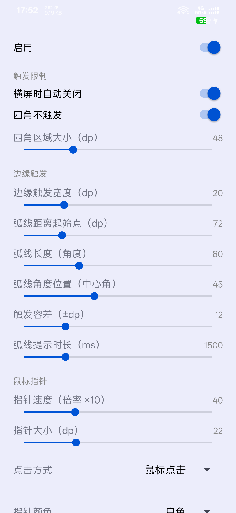

# 鼠标指针（边缘弧线触发）

[](https://github.com/dmyn1993/mouse-pointer/actions/workflows/build.yml)

> 下载 APK：<https://github.com/dmyn1993/mouse-pointer/releases>

运行在 system_server 的输入模块：在屏幕左/右边缘按下手指，内侧会出现一条很细的**弧线**；
手指**划过弧线**后出现一个**电脑鼠标箭头指针**，移动手指即可移动指针（元素出现 hover 悬停效果），
松手在指针位置点击。



- 边缘按下后触摸事件由模块消费并实时转发给系统/App：横向侧滑时系统返回箭头正常出现、松手正常返回，
  竖向滚动/拖滚动条也不受影响；
- 划过弧线：取消正在进行的返回/滚动手势（ACTION_CANCEL），隐藏弧线，启动指针；松手 = 点击；
- 没划过弧线就松手：手势照常完成，不触发指针。

## 包名与版本

- 应用/模块名：`鼠标指针`
- 包名：`com.dmyn.mousepointer`
- 版本：versionCode **2** / versionName **1.1.0**（release 签名）
- Xposed 作用域：`android`（系统框架 / system_server）

## 参数（全部可在 App 内调整，实时生效）

### 触发限制
| 参数 | 范围 | 默认 | 说明 |
|---|---|---|---|
| 启用 | 开/关 | 开 | 总开关 |
| 横屏时自动关闭 | 开/关 | 开 | 屏幕横屏时完全不触发（避免游戏误触） |
| 四角不触发 | 开/关 | 开 | 屏幕四个角落不触发 |
| 四角区域大小 | 8–160dp | 48dp | 每个角落的方形排除区域边长 |

### 边缘触发
| 参数 | 范围 | 默认 |
|---|---|---|
| 边缘触发宽度 | 8–64dp | 20dp |
| 弧线距离起始点（半径） | 24–260dp | 72dp |
| 弧线长度（角度） | 10–180° | 60° |
| 弧线角度位置（中心角） | 0–120° | 45° |
| 触发容差 | 4–40dp | 12dp |
| 弧线提示时长 | 500–5000ms | 1500ms |

### 鼠标指针
| 参数 | 范围 | 默认 |
|---|---|---|
| 指针速度 | ×1.0–×12.0 | ×4.0 |
| 指针大小 | 12–48dp | 22dp |
| 点击方式 | 鼠标点击 / 触摸点击 | 鼠标点击 |
| 指针颜色 | 白/黑/绿/蓝/橙 | 白色 |
| 悬停反馈 | 开/关 | 开 |

### 反馈与调试
| 参数 | 默认 |
|---|---|
| 触发时震动 | 关 |
| 点击时震动 | 关 |
| 调试日志 | 关 |

底部按钮 **恢复默认设置** 带二次确认弹窗，防止误触。

## 点击注入

鼠标点击使用真实鼠标事件序列：`ACTION_DOWN → ACTION_BUTTON_PRESS → ACTION_BUTTON_RELEASE → ACTION_UP`
（Chromium/WebView 会忽略鼠标 toolType 的 DOWN/UP，只处理 `ACTION_BUTTON_*`；普通 Android View
使用 DOWN/UP 完成点击）。个别 App 不兼容时可在 App 内切换为「触摸点击」。

## 构建

环境：JDK 17、Android SDK Platform 36（compileSdk 36 / minSdk 35 / targetSdk 36）。

```bash
# 调试包
./gradlew :app:assembleDebug
# Release 包（使用 keystore/release.jks 签名）
./gradlew :app:assembleRelease
```

产物：
- Debug：`app/build/outputs/apk/debug/app-debug.apk`
- Release：`app/build/outputs/apk/release/app-release.apk`

### Release 签名

仓库**不包含**签名密钥。Release 签名通过环境变量读取（见 `app/build.gradle.kts`）：

```bash
export MOUSE_POINTER_STORE_PASSWORD=***
export MOUSE_POINTER_KEY_ALIAS=***
export MOUSE_POINTER_KEY_PASSWORD=***
# 并把 keystore 放到 keystore/release.jks
./gradlew :app:assembleRelease
```

如果环境变量或 keystore 缺失，release 任务会产出**未签名** APK（CI 中由 secrets 提供签名）。

## 自动构建与发布（GitHub Actions）

工作流：`.github/workflows/build.yml`，触发条件：

- push 到 `main`/`master`：自动构建 release APK，并更新 GitHub Release 里 `latest`（预发布）的 APK；
- push 版本 tag（如 `v1.1.0`）：创建同名正式 Release，附 APK 并自动生成 release notes；
- 手动 `workflow_dispatch`：只构建并上传 artifact。

仓库需要在 Settings → Secrets and variables → Actions 中配置以下 secrets（工作流即可签名出可安装的 release APK）：

| Secret | 说明 |
|---|---|
| `KEYSTORE_BASE64` | `keystore/release.jks` 的 base64 编码（`certutil -encodehex -f` 或 `base64 -w0`） |
| `STORE_PASSWORD` | keystore 密码 |
| `KEY_ALIAS` | 签名 key 别名 |
| `KEY_PASSWORD` | 签名 key 密码 |

## 安装与启用

```bash
adb install -r mouse-pointer-release.apk
```

1. LSPosed 中启用「鼠标指针」，作用域只勾「系统框架 / android」；
2. 重启手机（system_server 里的模块代码只在启动时加载，安装/更新后必须重启）；
3. 打开 App 调整参数，修改立即通过签名权限广播下发给 system_server，并写入
   `Settings.Global`（key：`mouse_pointer_config`，JSON 字符串）。

## 已测试项（v1.1.0 release）

- App 界面：参数滑条/开关/下拉框、恢复默认二次确认弹窗（取消不生效、确认后全部恢复默认）；
- 配置广播与持久化：App 修改 → 广播 → system_server 模块应用并写入 `Settings.Global`；
- 弧线触发：模拟触摸划过弧线 → 指针启动 → 松手点击注入成功；
- 未划过弧线（水平滑动）：不触发指针；
- 四角排除：角落按下不触发；
- 横屏自动关闭：横屏时按下不触发；关闭该选项后横屏可正常触发；
- Release APK 安装、模块加载（InputFilterEnabled）验证通过。

## 已知限制

- 安装/更新 APK 后必须重启手机，system_server 才会加载新模块代码。
- 触摸被模块消费后以注入事件转发；极少数 App 可能识别为模拟输入而不响应。
- hover 悬停视觉由目标 App 决定（Material/Compose/WebView/SystemUI 一般有，自定义 View 可能没有）。
- 注入指针不显示系统鼠标光标，个别系统日志可能出现 `Cannot set pointer icon` 警告（无害）。
- 仅支持 Android 15+（minSdk 35）。

## 许可

GPLv3（见 `LICENSE`）。
